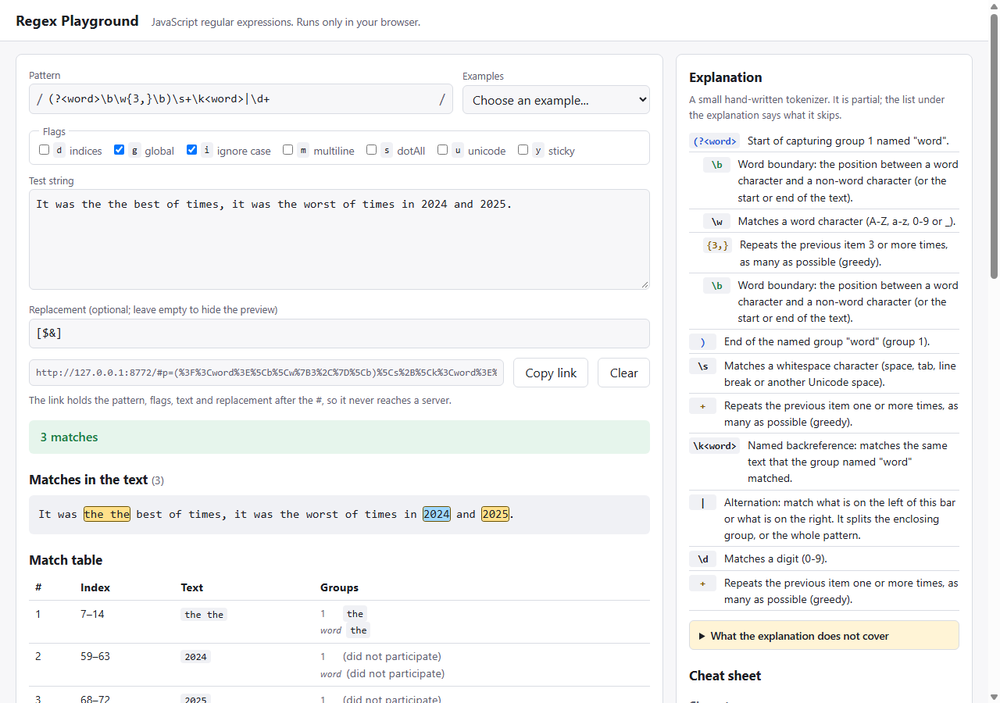

# regex-playground

A small regex tester that runs entirely in the browser: type a JavaScript regular expression and a test string, and see every match highlighted, a table of capture groups, a replace preview and a plain-English explanation of the pattern. It has no dependencies and no build step. It is a learning and showcase project, not a replacement for regex101.



## What it does

- **Highlighted matches.** The test string is shown with every match highlighted in two alternating colours, so adjacent matches stay distinguishable. A zero-length match is drawn as a thin red marker.
- **Match table.** Index range, text, every numbered and named group (a group that did not take part is shown as "did not participate"), and the start and end index of each group when the `d` flag is on.
- **Replace preview.** Uses JavaScript replacement syntax (`$1`, `$<name>`, `$&`, `$$`, `` $` ``, `$'`) through `String.prototype.replace`. The preview appears when the replacement field is not empty, so previewing "replace with nothing" is not possible.
- **Explanation.** A hand-written tokenizer lists each token of the pattern with a one-line description: character classes, escapes, quantifiers (greedy and lazy), capturing, named and non-capturing groups, lookahead and lookbehind, anchors, alternation and backreferences. **It is partial**; see Limits.
- **Safe against catastrophic backtracking.** Matching runs in a Web Worker. If it has not answered after 2 seconds, the page terminates the worker and shows "Timed out: possible catastrophic backtracking". The page stays usable. Try the last example, `(a+)+$` on `aaaaaaaaaaaaaaaaaaaaaaaaaaaa!`.
- **Invalid patterns and flags** show the engine's own error message.
- **Limits on output.** At most 1000 matches are listed and highlighted; the page says when there are more. Zero-length matches are stepped over by hand, so `/a*/g` cannot loop forever.
- **Ten examples and a cheat sheet** in the page.
- **Sharing by URL hash.** The pattern, flags, text and replacement are encoded after the `#` of the address. A hash is never sent to a server, and the app makes no network requests of its own. Light and dark themes follow the system setting.

## Run it

Needs Node 20 or newer, only to serve static files and to run the tests.

```
npm start            # http://127.0.0.1:8080/   (PORT=3000 npm start to change the port)
npm test             # 70 tests
```

Open it over http, not by double-clicking `index.html`: browsers do not start Web Workers from `file://` pages, and the app then shows an error saying so. Any static server works, for example `python -m http.server`. `npm start` serves only `index.html` and `src/`.

## How it is built

```
index.html, src/styles.css   page and styling
src/app.js                   DOM only: inputs, rendering, URL hash, the Worker with its timeout
src/core.js                  runMatches, segmentText, applyReplacement, explain, encodeState / decodeState
src/worker.js                Web Worker wrapper around core.js
src/lib.js                   example presets, cheat sheet and small display helpers (UI-free)
scripts/serve.js             the static server behind `npm start`
test/                        node:test suites
```

`core.js` and `lib.js` are UMD modules: the page and the Worker load them as plain scripts, and the Node tests `require` them, so the tests exercise the same code the browser runs. The UI is built with `createElement` and `textContent` only; nothing from the pattern, the text or a match is ever inserted as HTML.

Match indices are UTF-16 code units, as in JavaScript. With the `u` flag an empty match advances by a whole code point; without it, by one code unit (so `/(?:)/g` finds 3 empty matches in one emoji, and 2 with `u`).

## How it is tested

70 Node tests, all passing on Node 24 on Windows:

- **Known answers** (`core.test.js`): numbered and named groups, groups that did not participate, `d` indices, lookbehind and lookahead, backreferences, `i` / `m` / `s` / `u` / `y`, matches without `g`, the 1000-match limit and its truncation flag, invalid patterns and invalid or duplicate flags, replacement syntax, and catastrophic backtracking being stopped by an outside timeout (`vm` here, `Worker.terminate` in the page).
- **Zero-length matches**: `/a*/g` on `baac`, `/(?:)/g` on an emoji with and without `u`, empty text, and a sticky empty match.
- **Seeded random property tests**: `segmentText` always reproduces the input exactly, never overlaps and keeps every match in order; `encodeState` then `decodeState` is the identity for random strings that include emoji, lone surrogates, `%`, `&`, `=`, `#` and empty fields; `decodeState` never throws on random garbage. Seeds are fixed, so a failure is reproducible.
- **Cross-check against a second implementation, for literal patterns only.** For random patterns made only of the letters `a` and `b` (no metacharacters), `runMatches` is compared with a naive hand-written scanner, with and without `i`. For patterns with real regex syntax there is no independent oracle in the tests: those results are known-answer cases whose expected values I worked out by hand.
- **The explainer** (`explain.test.js`): hand-written expected output for each token type, plus checks that it never throws on random input and that its token texts cover the pattern in order.
- **Presets, helpers and server** (`lib.test.js`, `serve.test.js`): every example gives its stated number of matches, and path-traversal attempts against the static server.

Beyond those, I drove the real page in headless Chrome once, by hand, with a throwaway smoke script appended to a copy of the app (the check ran in real time, with Chrome controlled over the DevTools protocol from a small Node script). It confirmed: typing a pattern highlighted matches with alternating styles and empty-match markers; `(a+)+$` on `aaaaaaaaaaaaaaaaaaaaaaaaaaaa!` showed "Timed out: possible catastrophic backtracking" after about 2.2 seconds while a 50 ms timer on the page kept ticking (43 ticks), and typing a new pattern afterwards worked; an invalid pattern showed `Invalid regular expression: /(/g: Unterminated group`; the replace preview and the `d` column worked; a hash set from outside loaded into the inputs and typed input was written back into the hash and the share field; 1500 matches showed "First 1000 matches shown"; a text containing `` stayed plain text. The smoke script is not part of this repo, so the browser UI has no automated test here. The screenshot above was taken from the same headless Chrome. One harness caveat: with `--virtual-time-budget` the page's 2 second timer can fire before the Worker's reply arrives, producing a false "Timed out"; that is a quirk of virtual time, so the check was run without it.

## Limits

- The explanation is **partial** and is not a validator. It does not look up `\p{...}` property names, does not explain inline modifier groups such as `(?i:...)`, does not understand `v`-flag class set syntax, and cannot tell a backreference from a legacy octal escape. It flags a few obvious syntax errors but the engine's error message is the authority.
- JavaScript (V8-style) regular expressions only; other flavours such as PCRE or Python differ. The flag checkboxes cover `g i m s u y d`; the `v` flag is not offered, and a `v` in a shared link is dropped.
- The 2 second timeout is a heuristic. A very large text can also time out without any catastrophic pattern, and a pattern that is slow but finishes in under 2 seconds is not flagged. The worker is not a security sandbox.
- Shared links carry the whole state in the URL, so a very large text makes a very long link; there is no size cap.
- The tool shows at most 1000 matches. The replace preview is not capped, so it always reflects every match.
- Tested in Chrome only (headless, once, as above). Other browsers are untested, though the app uses only standard APIs (`Worker`, `history.replaceState`, optional `navigator.clipboard`). The copy button falls back to selecting the link field if the clipboard is unavailable.
- Not deployed anywhere. To publish it, enable GitHub Pages for the repository and serve the repository root.
- CI: the workflow (`.github/workflows/ci.yml`) runs `npm test` on Node 20, 22 and 24. CI ran green on all three Node versions on the first run on GitHub Actions (ubuntu-latest, 2026-10-20).

## Clone

```
git clone https://github.com/Supp3r-Man/regex-playground.git
cd regex-playground
npm start
```

MIT licensed.
